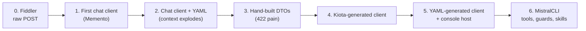

# CodeCamp CHC 2026: Bootstrapping from an HTTP POST

Proof-of-concept projects from my CodeCamp Christchurch 2026 session, showing how I bootstrapped a Mistral AI client from a single hand-crafted HTTP request, with no client libraries, no SDKs and climbed the ladder to a console CLI with tools, permissioning, and loadable skills.

The projects are numbered in the order I built them, which is also the order of the talk.

## The ladder



## Projects

| # | Project | What it demonstrates |
|---|---------|----------------------|
| 0 | `Fiddler` | Raw chat-completion HTTP requests captured from Fiddler, the PowerShell script that sets the API key, and the "just code no thinking" prompt-escalation experiments. |
| 1 | `FiddlerChatCompletionAPI` | First working console client: one request, one response. Model-selection experiments (small/medium/large), and why large made response parsing go pop. |
| 2 | `ChatCompletionFiddler` | The full OpenAPI spec (49,000 lines) re-sent with **every turn** of a chat loop: ~300K tokens against a 128K window. The context blow-out, on disk. |
| 3 | `ChatCompletionDTO` | Hand-built DTOs: the PascalCase 422 trap (`RequestJsonInvalid1/2.json`), the `system.md` conventions file, and the trimmed 296-line chat-completions spec that made grounding possible. |
| 4a | `KiotaClientLibrary` | The Microsoft Kiota-generated client, via `KiotaCommandLine.txt` with `--include-path /v1/chat/completions`: 49,000 lines of spec filtered at generation time. |
| 4b | `KiotaClientApplication` | Console host for the Kiota client, including the generated tool-calling scaffolding. |
| 5a | `YAMLClientLibrary` | Client library generated by the model from the 296-line spec: typed DTOs, correct casing, no pleading. |
| 5b | `YAMLClientApplication` | Console host with context management (`ResponseWithContextManagement.txt`) and skills responses captured. |
| 6 | `MistralCLI` | The finished CLI: local tool execution, permissioning (`ToolExecutionResult` with `PermissionDenied`), `_ignore.json`, `/save` and `/clear`, and loadable skills in `Skills/`. |

## The 49,000 → 296 story

The official spec at <https://docs.mistral.ai/openapi.yaml> covers the whole API — files, OCR, insertions, the works — at 49,000 lines / 1.5 MB. It cannot fit in a context window, and re-sending it every turn is worse. The trimmed chat-completions-only spec used here is **296 lines / ~10 KB**, extracted by [API Evangelist](https://apievangelist.com/): [mistral-ai-chat-completions-api-openapi.yml](https://github.com/api-evangelist/mistral-ai/blob/main/openapi/mistral-ai-chat-completions-api-openapi.yml). It is community-maintained, not official — pin your version if you build on it.

## Getting started

Requires .NET 10 SDK. Your Mistral API key goes in .NET user secrets for local development (right-click the CLI project → **Manage User Secrets**):

```json
{
  "MistralAi:ApiKey": "<your key>"
}
```

For deployments, set `MistralAi__ApiKey` via your secret-management mechanism. See `MistralCLI/README.md` for full details, including skill-file format and the `/save` / `/clear` semantics.

## Resources

- [Mistral API documentation](https://docs.mistral.ai/)
- [Official OpenAPI spec](https://docs.mistral.ai/openapi.yaml)
- [API Evangelist per-endpoint spec extracts](https://github.com/api-evangelist/mistral-ai)
- [Microsoft Kiota](https://learn.microsoft.com/openapi/kiota/)
- [Fiddler](https://www.telerik.com/fiddler)

## Notes

Each project carries its own `Notes.txt` - the raw engineering log from the session: what worked, what 422'd, and what I didn't bother investigating. The responses, failures, and captures referenced in the talk are all committed alongside the code, so the evidence trail is reproducible.

MIT licensed. 
